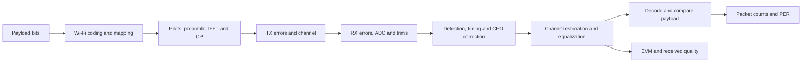

# MATLAB OFDM and Wi-Fi simulator training guide

**Audience:** Engineers learning OFDM or reproducing conducted Wi-Fi RX measurements.
**Environment:** MATLAB R2018a. The basic study uses base MATLAB; the Wi-Fi simulator requires WLAN System Toolbox.
**Guide date:** 2026-10-28.

This guide covers the reviewed 3.1 code. This guide is published with the 3.1 update. Check `VERSION`, `CHANGELOG.md`, and `git status` before assuming two machines have identical features.

## Contents

1. [Which project should I use?](#1-which-project-should-i-use)
2. [Run from a separate test folder](#2-run-from-a-separate-test-folder)
3. [Understand the signal chain](#3-understand-the-signal-chain)
4. [First lab: basic OFDM](#4-first-lab-basic-ofdm)
5. [Second lab: conducted RX PER](#5-second-lab-conducted-rx-per)
6. [Read the measurements correctly](#6-read-the-measurements-correctly)
7. [DC and IQ calibration lab](#7-dc-and-iq-calibration-lab)
8. [Sensitivity and refinement](#8-sensitivity-and-refinement)
9. [Test plans and saved-run comparisons](#9-test-plans-and-saved-run-comparisons)
10. [Find code, results, and validation](#10-find-code-results-and-validation)
11. [Common problems and model limits](#11-common-problems-and-model-limits)
12. [Suggested training session](#12-suggested-training-session)

## 1. Which project should I use?

| Project | Location | Main purpose |
|---|---|---|
| Basic OFDM study | `C:\Codex\ofdm` | Learn QPSK, IFFT/FFT, cyclic prefix, multipath, equalization, and BER. |
| Wi-Fi OFDM simulator | `C:\Codex\ofdm-wifi` | Generate and recover actual 11a/g/n/ac PHY packets; study RF errors, PER, EVM, and sensitivity. |
| Wi-Fi GitHub repository | [skk4you/wifi-ofdm](https://github.com/skk4you/wifi-ofdm) | Published code/history. Local features may be newer until committed and pushed. |

Use the basic project to understand *why OFDM works*. Use the Wi-Fi project to run packet-based engineering experiments.

The basic study has 52 QPSK data carriers and no Wi-Fi coding, pilots, or packet acquisition. It is not an IEEE Wi-Fi waveform generator. The Wi-Fi project delegates standards-specific waveform generation and decoding to the installed WLAN toolbox.

## 2. Run from a separate test folder

Create a folder for your experiment. In MATLAB:

```matlab
mkdir('C:\Codex\ofdm-wifi\test_output\MyTraining')
cd('C:\Codex\ofdm-wifi\test_output\MyTraining')
addpath('C:\Codex\ofdm-wifi')
pwd
which wifi_rx_per
```

The example stays inside this workspace; you may instead use your own existing test directory.

Run drivers **by name** after `addpath`. They use the MATLAB current folder for output:

```matlab
run_rx_per
```

Single runs get timestamped subfolders under `results/rx_per`. Plans and comparisons have their own parents. The actual path is returned in `r.outputDir`, `plan.outputDir`, or `comparison.outputDir`.

Avoid `run('C:\Codex\ofdm-wifi\run_rx_per.m')` for this workflow: MATLAB may temporarily change the current folder. Also, setting `cfg` in the console before running a driver does not override the driver's assignments. Edit the driver itself, or call the underlying function with your configuration.

## 3. Understand the signal chain



- **Coding/mapping:** Turns payload bits into a protected constellation-symbol sequence.
- **IFFT/CP:** Creates the OFDM waveform and protects it against sufficiently short channel memory.
- **Preamble/training:** Helps the receiver find the packet, correct timing/frequency, and estimate the channel.
- **Equalization:** Compensates carrier-dependent channel gain/phase.
- **Payload comparison:** A synchronized packet counts as successfully received only if its recovered PSDU matches the known transmitted bits.

A packet can be detected and still have payload errors. Such a packet contributes to PER and, when its equalized symbols are finite, to EVM. No acquisition means no useful EVM/SNR measurement for that packet.

## 4. First lab: basic OFDM

Use the reviewed sources from `ofdm-basic` for this lab. The publication fixes a scalar-channel FFT shape issue in older copies. If you still have the original `C:\Codex\ofdm` files, update them from that repository first.

In MATLAB:

```matlab
addpath('C:\Codex\ofdm')
flat = ofdm_study(struct('channel',1));
multi = ofdm_study;
noCP = ofdm_study(struct('cpLength',0,'ebN0dB',0:4:28));
check_ofdm_study
```

Observe:

1. A flat AWGN channel should follow the QPSK BER reference within Monte Carlo variation.
2. Multipath changes the carrier gains. Equalization can amplify noise in weak carriers.
3. Removing the CP can create interference that persists at high SNR.

Read `ofdm_study.m` in order. Locate mapping, carrier allocation, IFFT, CP insertion, channel convolution, FFT, equalization, and bit decisions.

This project's horizontal axis is **Eb/N0**. It is not interchangeable with the Wi-Fi project's packet sample SNR or DUT input power in dBm.

## 5. Second lab: conducted RX PER

For everyday use, open `run_rx_per.m` and edit its sections:

| Section | Main settings |
|---|---|
| Wi-Fi mode | `standard`, `mcs`, `band`, `channelNumber`, `bandwidth` |
| Packet format | `payloadBytes`, `coding`, `guardInterval` |
| Measurement | `inputPowerDBm`, `packetsPerLevel`, `perThreshold` |
| Receiver | `noiseFigureDB`, `referenceInputDBm`, `adcBits`, `adcFullScale` |
| Calibration/errors | RX DC/IQ, trim enables, CFO, phase noise, TX IQ/PA |
| Reporting | `snrMetric`, `makePlots`, `outputDir`, `uniqueOutputDir` |

For a short learning run, call:

```matlab
cfg = struct('standard','11ac','mcs',3, ...
    'band','5GHz','channelNumber',36,'bandwidth',20, ...
    'inputPowerDBm',-90:5:-60,'packetsPerLevel',50, ...
    'payloadBytes',512,'snrMetric','mer');
r = wifi_rx_per(cfg);
disp(r.summary)
```

For an office-style run, change the driver to 1,000 packets per level and the desired 1 dB power grid. A -100:1:-50 dBm sweep sends 51,000 packets. Start with fewer levels/packets while learning.

The conducted test holds receiver noise fixed. Input dBm is the power at the **DUT reference plane**, after any cable loss you account for externally. With a 290 K reference, 20 MHz sample bandwidth, and 7 dB noise figure, the modeled integrated noise floor is approximately -94 dBm. The model does not scale noise upward as input power increases.

## 6. Read the measurements correctly

### PER and received count

```text
LostOrBad = Sent - ReceivedOK
PER = LostOrBad / Sent
PERPercent = 100 * PER
```

Exactly `packetsPerLevel` packets are attempted at every tested power, including weak levels. Acquisition failures count as lost.

For example: 1,000 sent and 847 received correctly gives 153 lost and **15.3% PER**.

Zero observed errors does not establish zero true PER. Read the 95% Wilson interval. After zero errors in 1,000 packets, its upper bound is about 0.38%; the defaults of small training runs have much wider bounds.

### EVM

RMS EVM compares equalized received symbols with a clean transmitted reference:

```text
EVM% = 100 * sqrt(sum(|received - reference|^2) / sum(|reference|^2))
EVMdB = 20 * log10(EVM% / 100)
```

Lower EVM is better. More negative EVM dB is better. In these results, EVM includes acquired packets with payload errors and excludes packets that were not acquired.

### Three different SNR-related quantities

| Quantity | Meaning |
|---|---|
| Input `SNRdB` | Configured input signal/noise budget. Can rise nearly linearly with input dBm. |
| `ReceivedSNRdB` / `LTFNoiseSNRdB` | Received training-symbol noise estimate. Repeated static distortion can cancel. The older column name remains for compatibility. |
| `ReceivedMERdB` | Effective received SNR from the actual residual EVM, including noise and distortion. Default plot in the local 3.1 code. |

Select the plotted metric:

```matlab
cfg.snrMetric = 'mer'; % Effective SNR = -20*log10(EVM%/100)
% cfg.snrMetric = 'ltf'; % Separate repeated-training noise estimate
```

MER is a reference-assisted quality metric, not an independent firmware SNR reading. It is the negative of EVM in dB. If EVM worsens through overload, MER decreases.

| EVM | MER |
|---:|---:|
| 10% | 20 dB |
| 1% | 40 dB |
| About 0.562% | 45 dB |
| 0.1% | 60 dB |

A real DUT's peak near 45 dB requires the corresponding impairment floor or its reporting behavior. The simulator does not force a universal 45 dB ceiling. Ideal settings can still produce a nearly linear quality curve.

## 7. DC and IQ calibration lab

Use the same input powers and packet budget to compare an impaired receiver before and after trim:

```matlab
cfg = struct('inputPowerDBm',-90:5:-60,'packetsPerLevel',50, ...
    'rxDC',0.12+0.08i,'rxIQGainDB',1.5,'rxIQPhaseDeg',8, ...
    'dcTrim',false,'iqTrim',false,'snrMetric','mer');
rOff = wifi_rx_per(cfg);
cfg.dcTrim = true;
cfg.iqTrim = true;
rOn = wifi_rx_per(cfg);
comparison = wifi_compare_rx_runs({rOff,rOn},{'Trim off','Trim on'});
```

Inspect PER, EVM, MER and `rOn.link.frontendMetrics`. The latter contains an independent tone's residual DC, image rejection, and RMS error.

The model calibrates using a separate known tone; it does not use the test payload to fit trim coefficients. Its digital trim cannot recover samples already lost to clipping. A constant DC offset alone may have little impact on data EVM because Wi-Fi leaves DC unused; inspect residual DC directly.

For a simplified overload demonstration, use finite `adcBits` and an appropriate fixed gain/full scale. This creates a fixed-gain ADC experiment, not a measured AGC/LNA model.

## 8. Sensitivity and refinement

Sensitivity is evaluated at `perThreshold`, normally 0.10 (10% PER).

| Status | Interpretation |
|---|---|
| `bracketed` | A failing power immediately precedes the first passing point. |
| `below_sweep` | The weakest point already passes; extend toward weaker inputs to locate the crossing. |
| `no_pass` | Nothing passes; extend the range or investigate the receiver configuration. |

Inspect:

```matlab
r.lowestPassingDBm
r.sensitivity
r.passWindowsDBm
```

`lowestPassingDBm` is a measured grid point. `r.sensitivity.estimateDBm` is a linear interpolation between the measured failing/passing bracket. It is not another measured point or a sensitivity confidence interval.

Optional refinement:

```matlab
cfg.refineSensitivity = true;
cfg.refinementStepDB = 1;
r = wifi_rx_per(cfg);
```

The simulator announces additional measurements. A coarse bracket [-85, -80] dBm adds -84, -83, -82 and -81 dBm. Existing endpoints are not repeated. Every added point uses the same packet budget. Unbracketed sweeps are not extended automatically.

Use `r.testedPowerDBm` and `r.summary` for all actual points. `r.settings.inputPowerDBm` preserves the requested coarse range.

## 9. Test plans and saved-run comparisons

### Run a matrix

Edit `run_rx_plan.m`, then type:

```matlab
run_rx_plan
disp(plan.summary)
```

The supplied matrix has eight separate tests: two MCS values, two channels, and two trim states. At the default 11 powers and 1,000 packets per level, this is 88,000 packets before refinement.

Each test gets its own folder. The plan saves a summary/checkpoint after each completed or failed case. Execution status `completed` means the test ran; it does not mean it met the PER specification. Invalid tests are recorded and later tests continue when `continueOnError=true`.

### Overlay saved measurements

Run:

```matlab
run_compare_rx
```

With no paths entered, select an individual timestamped run folder or a plan folder in the folder picker. Repeat, then Cancel to finish selection. Alternatively, edit `runFolders` and `labels` in the driver.

Completed plan cases expand into separate curves. Failed/empty cases are skipped. No packets are rerun. Each original power grid and its NaN gaps are retained.

Use explicit labels such as “Revision A - trim off” and “Revision B - trim on” for software comparisons. The current source version cannot establish which historical revision generated an old measurement.

Check mode, payload, coding, bandwidth, noise figure, gain/ADC settings, packet counts, and metric selection before treating two curves as a controlled comparison. MCS 3 does not represent the same modulation/coding in every Wi-Fi standard.

## 10. Find code, results, and validation

### Code map

| File | Responsibility |
|---|---|
| `wifi_defaults.m` | Shared simulation defaults. |
| `wifi_sim.m` | Packet TX/channel/RX loop and metrics. |
| `wifi_rx_frontend.m` | RX DC/IQ, ADC, calibration and digital trim. |
| `wifi_rx_per.m` | Conducted dBm sweep, fixed packet budget and export. |
| `wifi_rx_sensitivity.m` | Crossing/bracket extraction. |
| `wifi_rx_plan.m` | Sequential multi-configuration tests and checkpoints. |
| `wifi_compare_rx_runs.m` | Saved-run overlays and comparison exports. |
| `wifi_evm_to_mer.m` | Explicit EVM-to-effective-SNR conversion. |
| `run_rx_per.m` / `run_rx_plan.m` / `run_compare_rx.m` | Editable user drivers. |
| `README.md` | Detailed usage, settings and limitations. |
| `VALIDATION.md` | Checks actually run and their scope. |
| `CHANGELOG.md`, `VERSION` | Feature/version history. |

### Important saved files

- A single run: `configuration.mat/json`, `rx_per.mat/csv/png`, `sensitivity.csv`.
- A plan: `plan_configuration.mat`, `plan_summary.csv`, `plan_results.mat`, per-test folders, and error records.
- A comparison: `comparison.mat/png/fig`, `comparison_manifest.csv`, `comparison_points.csv`.

The configuration MAT file preserves exact types, complex values and Inf. JSON is a readable companion; complex values use real/imaginary fields and scalar Inf controls are represented as text.

### Validation commands

```matlab
check_wifi_sim
check_wifi_rx_workflow
check_wifi_compare_rx
check_wifi_rx_snr_metrics
check_wifi_rx_per(struct('inputPowerDBm',[-100 -82 -60], ...
    'packetsPerLevel',20,'makePlots',false)) % Quick override
% check_wifi_rx_per % Full configured packet budget and grid
```

The `check_*` functions run multiple validation cases. They are not single office-style measurements. The default `check_wifi_rx_per.m` power range retains the edited -100:5:0 dBm grid; inspect it before starting a potentially long run. Explicit overrides allow a short regression without changing that driver.

### Git inspection in PowerShell

```powershell
git status --short
git log --oneline -6
git diff
git meld
```

A local `VERSION` file can describe uncommitted work. Use the commit ID plus `git status` when recording reproducible revisions.

## 11. Common problems and model limits

| Observation | What to check |
|---|---|
| Results appear in the source folder | Check `pwd`; use `addpath` and invoke the driver by name. |
| Test runs more than once | Use a `run_*` measurement driver, not a `check_*` regression function; verify refinement is disabled if unwanted. |
| No high-power PER rise | Ideal ADC/linear receiver is enabled. A bathtub needs a modeled overload mechanism. |
| SNR keeps rising | Confirm MER versus LTF selection and whether any hardware impairment floor is modeled. |
| EVM/SNR is missing at weak power | No acquisition; the simulator reports a gap rather than inventing a measurement. |
| Trim barely changes PER | Coding may recover every packet even when EVM changes. Compare residual DC, image rejection and EVM too. |
| Different channels look identical | Channel number is metadata; channel-dependent RF tuning/loss/NF is not synthesized. |
| Different standards look unexpectedly different | Match modulation/coding, payload, bandwidth, GI and packet budget; do not assume identical MCS numbers are equivalent. |

Implemented PHY formats are 11a/g OFDM, HT/11n and single-user VHT/11ac. HE/11ax, EHT/11be, MAC contention/ACK/retries, concurrent-radio operation, measured AGC gain states and calibrated DUT RF behavior are outside the current model. Core `wifi_sim` supports MIMO with suitable channels; conducted `wifi_rx_per` is one SISO radio.

## 12. Suggested training session

| Session | Exercise | Learning outcome |
|---|---|---|
| 20 minutes | Flat/multipath/basic OFDM; remove CP | Explain FFT carriers, CP and equalization. |
| 20 minutes | Short conducted RX power sweep | Explain sent/received counts, PER and acquisition. |
| 20 minutes | Trim off/on and saved comparison | Separate DC/IQ correction from packet decoding. |
| 15 minutes | MER versus LTF; enable fixed-gain ADC clipping | Explain noise-only versus noise-and-distortion quality. |
| 15 minutes | Enable refinement; inspect sensitivity CSV | Distinguish a measured pass point from an interpolated crossing. |
| 20 minutes | Reduce the sample plan, run it, compare completed cases | Navigate checkpoints, per-test configurations and provenance. |

Before a larger engineering study, be able to answer: Which commit/settings generated this run? Where is the DUT power reference plane? Which SNR metric is shown? How many packets support each point? Is the sensitivity bracketed? Which hardware effects are modeled?
